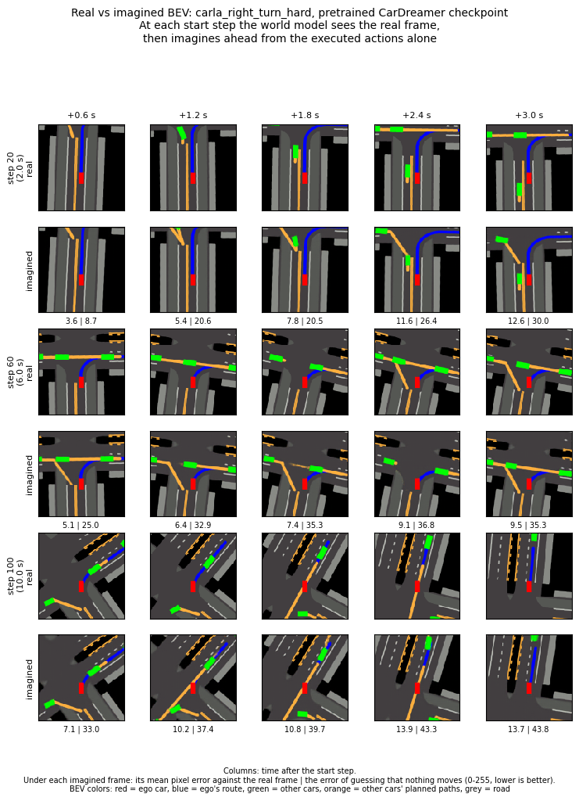

# notes/

Our own notes for the World Model + CBF project (AICPS lab, UC Irvine).
Nothing in this folder is upstream CarDreamer code; the project brief is in `../CLAUDE.md`.

| File | What it covers | Written in step |
|---|---|---|
| `README.md` | this index + the step log below | 1 |
| `codebase_walkthrough.md` | one `step()` of `carla_right_turn_hard`: config → env → observer → BEV → reward → termination | 2 |
| `stages_1_3.md` | each stage 1–3 module: inputs/outputs/shapes, and how it maps to (O_t, l), E, D, R, π, C, u_nom; measured shapes and parameter counts; open questions for the mentor | 7 |
| `figures/right_turn_hard_dream.png` | the trained world model "dreaming" 3 s of the right turn while its actor drives (every 3rd imagined frame) | Phase B prep |

## Repo layout and git
- The clone lives in WSL at `~/projects/CarDreamer` (Linux filesystem: fast for Python, and OneDrive never touches `.git`).
- `master` = upstream CarDreamer, never committed to. All our work goes on `dev`.
- Remotes: `origin` = our fork (`toastedgrain/CarDreamer`), `upstream` = `ucd-dare/CarDreamer`.
  Pulling upstream fixes later: `git fetch upstream && git merge upstream/master` (on `dev`).

## Step log

### Step 1: repo setup (2026-10-21)
- Cloned `ucd-dare/CarDreamer` at upstream commit `1601324`, created the `dev` branch, added `notes/` and the project `CLAUDE.md`.
- Verify: `git branch` shows `* dev`; `git log --oneline -2` shows our commit on top of `1601324`.

### Step 2: code walkthrough (2026-10-21)
- Wrote `codebase_walkthrough.md`: one `step()` of `carla_right_turn_hard` traced through config → env → observer → BEV → reward → termination, with `file:line` references, plus a preview of where the DreamerV3 agent plugs in.
- Corrected facts in `../CLAUDE.md` that the code contradicted: right-turn steer set, BEV layers, waypoint format, collision lag, TTC meaning, and eval sampling.
- Verify: spot-check a few `file:line` references in the note; its last section has commands that run without CARLA.

### Step 3: package skeleton (2026-10-21)
- Created `wm_pipeline/`, our own package, separate from upstream. It has a README with the package rules and the planned modules for Steps 4–6, and `tests/test_smoke.py`, which checks that importing `wm_pipeline` never imports `carla` or `car_dreamer` (Phase A has no CARLA).
- Phase A Python environment: `.venv` in the repo root (already ignored by upstream's `.gitignore`), with Python 3.10.12, numpy 1.24.3 (upstream's pin) and pytest 9.1.1. Setup commands are in `wm_pipeline/README.md`.
- Verify: `.venv/bin/pytest wm_pipeline -v` gives 1 passed, and `git diff master --stat` lists only `notes/`, `wm_pipeline/` and `CLAUDE.md`.

### Step 4a: Stage 1 data structures (2026-10-21)
- `wm_pipeline/observation.py` defines what Stage 1 hands to the rest of the pipeline:
  - `Observation`: O_t = `bev` (128, 128, 3) uint8, plus l = `instruction`.
  - `RouteInstruction`: `waypoints` (N, 3) float64 rows of (x, y, yaw°), with N ≤ 60.
  - `VehicleState`: one car's position, yaw, velocity and 4-corner polygon.
  - `GroundTruthState`: `timestep`, `ego`, and `others` (never including the ego).
- `make_observation(raw_obs, route_waypoints)` keeps only the BEV (decision: BEV only, no camera) and the route.
- Every class checks its shapes and dtypes when it's created. Ground truth stays separate from `Observation`, so the world model never sees it.
- Verify: `.venv/bin/pytest wm_pipeline -v` gives 13 passed.

### Step 4b: minimal mock env + action decoding (2026-10-21)
- `wm_pipeline/actions.py`: `decode_action` turns an action into the `(acc, steer)` command with the same formula as `CarlaBaseEnv.get_vehicle_control`. The defaults are the right-turn values: index 0–14 → acc ∈ {−2, 0, 2} × steer ∈ {−0.9, −0.3, 0, 0.3, 0.9}. Continuous `[acc, steer]` is clipped to [−3, 3] × [−1, 1], where upstream clipping happens in DreamerV3's wrapper / CARLA.
- `wm_pipeline/mock_env.py`: `MockCarDreamerEnv` has the same `reset()` / `step()` 4-tuple and the same obs keys, shapes and dtypes as the real right-turn env, plus `route_waypoints()` and `ground_truth()`. It's deliberately minimal:
  - random-noise images;
  - the ego slides along a straight 48 m route at 4 m/s, whatever the action is;
  - 3 cross-traffic cars move at constant velocity;
  - nothing collides, and the reward is always 0;
  - the episode ends after `episode_length` steps;
  - it's seeded, so the same seed gives the same episode;
  - stepping before `reset()` or after the episode is over raises an error.
- The smoke test now imports every module in the package, so any module with a top-level `import carla` fails it.
- Verify: `.venv/bin/pytest wm_pipeline -v` gives 40 passed.

### Step 5: Stage 2 encoder (2026-10-21)
- New packages, all at upstream's pins and installed from `wm_pipeline/requirements-phase-a.txt`: jax/jaxlib 0.4.34 (CPU), optax, tensorflow-probability, tensorflow-cpu 2.13, ruamel.yaml, cloudpickle.
  TensorFlow is only there because importing DreamerV3's `embodied` package imports it.
- `wm_pipeline/dreamer_agent.py`: `make_config(size, overrides)` and `build_agent(config)` build a DreamerV3 agent the way `dreamerv3/eval.py` does, with the same observation and action spaces as the right-turn task.
- `wm_pipeline/encoder.py`:
  - `LatentState` is x_t, made of `deter` (GRU memory: 512 for small, 64 for xsmall), `stoch` (32 × 32, each row a one-hot sample) and `logit` (32 × 32, the distribution `stoch` was sampled from). `features()` gives deter + flattened stoch, which is what the heads read.
  - `DreamerEncoder.encode(obs, prev, prev_action)` runs upstream's own `preprocess` → CNN encoder → `rssm.obs_step` on the agent's weights, using upstream's `nj.pure` + `nj.jit` mechanism. `prev=None` means the first step of an episode.
- Key test: over two steps, with the same weights, BEV and random keys, `encode()` gives **bit-for-bit the same latent** as upstream's `agent.policy(..., mode="eval")`. I also confirmed the check fails when the random keys differ.
- Verify: `.venv/bin/pytest wm_pipeline -v` gives 47 passed in about 20 s.

### Step 6: Stage 3 planner, safety-filter slot and runner (2026-10-21)
- `Action` (in `actions.py`) is one command: `index`, `acc`, `steer`; `one_hot`, the agent's format, which is fed back to the encoder; and `env_action`, what `env.step()` takes. It covers continuous mode too, for the later CBF.
- `planner.py`, `DreamerPlanner`:
  - `act(x_t, seed)` samples u_nom from upstream's actor, exactly as eval mode does.
  - `imagine(x_t, actions, seed)` rolls the RSSM forward under given actions with no observations and decodes `bev` (H, 128, 128, 3) uint8 and `reward` (H,). It's the recipe of upstream's `WorldModel.report()` open-loop videos.
- Random keys: upstream's single policy call uses keys from one per-step seed in this order: prior sample, posterior sample, action sample. Our encoder and planner share the step seed, and the planner skips the encoder's two keys.
- `safety_filter.py`: `identity_filter(u_nom, gt) -> u_nom`, the slot the CBF will replace.
- `runner.py`: `run_episode(env, encoder, planner, safety_filter, seed, max_steps)` runs Stage 1 → 2 → 3 → filter → `env.step`. It feeds **u_safe**, the action actually executed, back to the encoder, and returns an `EpisodeLog` of `StepRecord`s (gt, u_nom, u_safe, reward, done, terminal flags).
- Key tests:
  - encoder + planner pick **exactly** upstream's eval action (and fail if the key skip is removed);
  - over a whole mock episode the runner chooses exactly what upstream's `agent.policy` loop chooses;
  - one imagined step gives exactly the encoder's next `deter`;
  - an "always brake" filter changes both what the env executes and what the world model is told.
- Verify: `.venv/bin/pytest wm_pipeline -v` gives 68 passed in about 20 s.

### Step 7: Stages 1–3 write-up (2026-10-21)
- Wrote `stages_1_3.md`. It contains:
  - the symbol map (O_t, l, gt, E, x_t, D, R, π, C, u_nom, u_safe, with what's used while driving);
  - one section per module;
  - a measured shapes and parameter-count sheet for `xsmall` and `small`;
  - the annotated control step;
  - what's verified and what isn't;
  - open questions for the mentor.
- Measured: `small` with the 128×128 BEV has 30.5M trainable parameters, not ~18M. 17.9M is the same preset at 64×64. Corrected in `../CLAUDE.md`.
- Phase A (Steps 1–7) is complete. Next is Phase B on the GPU machine.

### Phase B prep: the pretrained checkpoint on the laptop (2026-10-21)
- Downloaded `CarDreamer_checkpoints/right_turn_hard.ckpt` (371.0 MB) from `huggingface.co/ucd-dare/CarDreamer` to WSL `~/checkpoints/cardreamer/`, outside the repo. Its SHA-256 matches the published `1338b236…3351bbd`.
- Upstream checkpoints are **pickles**, and plain `pickle.load` can run code hidden in the file. `load_checkpoint` (in `dreamer_agent.py`) uses a restricted unpickler that only builds numpy arrays and optax optimizer-state NamedTuples. A safe inspection showed the file contains exactly those: `step` = 461,400, `replay` = None, and 100 arrays + 3 optimizer states.
- The checkpoint was trained in **float16**: upstream's float16 optimizer adds loss-scaling state. So the agent must be built with `jax.precision: float16`. Built that way, all 103 entries fit our 128×128 `small` agent exactly (30.5M trainable).
- `wm_pipeline/scripts/check_checkpoint.py` reruns every check and saves `figures/right_turn_hard_dream.png`:
  - the trained actor accelerates at the episode start;
  - in a 3 s dream, the model imagines the road, the ego car, the route turning right at an intersection, and cross traffic.
- Verify: `.venv/bin/pytest wm_pipeline -v` gives 74 passed (6 new loader tests, no download needed). With the checkpoint downloaded: `PYTHONPATH=. .venv/bin/python wm_pipeline/scripts/check_checkpoint.py --checkpoint ~/checkpoints/cardreamer/right_turn_hard.ckpt --out /tmp/dream.png`.

### Step 8: upstream eval of the pretrained checkpoint on the lab machine (2026-11-03)
- Ran upstream's `dreamerv3/eval.py` on `carla_right_turn_hard` with `right_turn_hard.ckpt`, on the lab PC (RTX 5080, 16 GB). The full setup and commands are in `../CLAUDE.md` section 4.
- Result over 289 episodes (50,000 steps, about 15 minutes):

  | Metric | Ours | Paper |
  |---|---|---|
  | Success | 100.00% | 99.58% |
  | Collision | 0.00% | 0.42% |
  | Avg speed (m/s) | 2.95 ± 0.02 | 2.92 |

  Also: out of lane 0%, time exceeded 0, avg episode length 171.3 steps, avg score 345.93.
- How to read it:
  - The results are consistent with the paper, but not better than it. If the true failure rate were the paper's 0.42%, there would still be about a 30% chance of 0 failures in 289 episodes. Zero failures only tells us the true rate is probably below about 1%.
  - The `±` from `eval_stats.py` is the standard error over 3 batches of episodes, so `0.00% ± 0.00%` means no batch had a failure, not that there's no uncertainty.
  - "Avg. Speed Over 4 Ratio" (73.75%) is mean speed ÷ 4 m/s (`eval_stats.py:65`), not the share of time spent above 4 m/s.
- Differences from upstream's setup: Triton matmul off (`--xla_gpu_enable_triton_gemm=false`, needed to avoid a compile crash), CARLA's Windows build with Python in WSL2, TensorFlow CPU build. No side-by-side run on upstream's exact setup was done, so their effect isn't measured.
- The metrics are on the lab machine in `logdir/eval_right_turn_hard/metrics.jsonl` (gitignored).
- Verify, on the lab machine from the repo root: `python dreamerv3/eval_stats.py --logdir ./logdir/eval_right_turn_hard`.
- Not done yet: Step 9 (our runner with the same checkpoint) and Step 10 (real vs imagined BEV).

### Step 9: our runner on CARLA, compared with upstream's eval (2026-11-05)
- `wm_pipeline/scripts/run_carla_eval.py` drove 50,000 steps of `carla_right_turn_hard` with our stages 1–3: the CARLA adapter, `Observation`, `DreamerEncoder`, `DreamerPlanner`, the identity safety filter, then `env.step`. It used `right_turn_hard.ckpt`, float16, on the lab machine's GPU.
- **Check 1, the same action at every step:** upstream's `agent.policy` ran alongside on the same frames with the same seeds. Every latent (deter, stoch, logit) was bit-identical and every action identical. The script stops at the first difference, and it reached its 50,000-step target, so no step differed. A 646-step test run before it also matched at every step.
- **Check 2, the same results:** both runs are scored by upstream's own `eval_stats.py`.

  | Metric | Upstream eval (Step 8) | Our pipeline | Paper |
  |---|---|---|---|
  | Episodes | 289 | 296 | — |
  | Success | 100.00% ± 0.00% | 99.66% ± 0.34% | 99.58% |
  | Collision | 0.00% ± 0.00% | 0.34% ± 0.34% (1 episode) | 0.42% |
  | Out of lane | 0.00% | 0.00% | — |
  | Avg speed (m/s) | 2.95 ± 0.02 | 2.98 ± 0.02 | 2.92 |
  | Avg episode length (steps) | 171.30 ± 1.83 | 169.16 ± 1.72 | — |
  | Avg score | 345.93 ± 0.11 | 343.52 ± 1.76 | — |
- How to read it:
  - **The one collision doesn't come from our wrapper.** Check 1 shows our pipeline chose exactly what upstream's policy chooses from the same frame. The two runs saw different traffic: the gap between cross-traffic cars is random (`np.random.uniform` in `carla_wpt_fixed_env.py`), and so is CARLA's traffic manager.
  - **1 collision in 296 episodes is consistent with 0 in 289.** If both runs had the same true rate, a split like this would be common. It is also close to the paper's 0.42%. The lower average score comes mostly from that episode: the collision penalty, and no destination bonus.
  - **Speed and episode length differ by about one standard error**, which is normal run-to-run variation. The `±` is the standard error over 3 batches of episodes (see Step 8).
- The metrics are on the lab machine in `logdir/runner_right_turn_hard/metrics.jsonl` (gitignored).
- Verify, on the lab machine from the repo root:
  - `PYTHONPATH=. python wm_pipeline/scripts/run_carla_eval.py --logdir <new dir>` should end with `DONE: all ... matched`.
  - `python dreamerv3/eval_stats.py --logdir <that dir>` gives the table.
  - On the laptop, `.venv/bin/pytest wm_pipeline -q` gives 92 passed.
- Next: Step 10, real vs imagined BEV.

### Step 10: real vs imagined BEV on CARLA (2026-11-05)
- `wm_pipeline/scripts/real_vs_imagined.py` drove one episode of `carla_right_turn_hard` with our pipeline and the pretrained checkpoint: 168 steps, destination reached. From steps 20 (approaching the junction), 60 (turning) and 100 (after the turn, in the cross-traffic lane), the world model imagined 3 s ahead. It started from the latent x_t and was given only the actions the car actually took, with no frames after the start.

  

- Mean pixel difference from the real BEV (0–255, lower is better). "No-move" is the error of guessing that nothing changes after the start frame.

  | Start step | | +0.6 s | +1.2 s | +1.8 s | +2.4 s | +3.0 s |
  |---|---|---|---|---|---|---|
  | 20 (approach) | model | 3.6 | 5.4 | 7.8 | 11.6 | 12.6 |
  | | no-move | 8.7 | 20.6 | 20.5 | 26.4 | 30.0 |
  | 60 (turning) | model | 5.1 | 6.4 | 7.4 | 9.1 | 9.5 |
  | | no-move | 25.0 | 32.9 | 35.3 | 36.8 | 35.3 |
  | 100 (after the turn) | model | 7.1 | 10.2 | 10.8 | 13.9 | 13.7 |
  | | no-move | 33.0 | 37.4 | 39.7 | 43.3 | 43.8 |

- How to read it:
  - **The model beats the no-move guess at every start and every horizon** (at 3.0 s: 12.6 vs 30.0, 9.5 vs 35.3, 13.7 vs 43.8). So it predicts how the scene moves; it isn't just repeating the last frame.
  - **Its error grows with the horizon**, as expected when imagining with no new frames.
  - **What it gets right:** the road layout turning with the ego, the route, the cross-traffic lane and the other cars' planned paths.
  - **What it gets wrong:** the exact positions and timing of other cars, clearest in the step 20 rows. The flow spawns cars at random gaps, so cars that appear after the start frame are probably partly unpredictable from the BEV.
  - **The error is averaged over the whole image,** most of which is static road. So compare the model against no-move, not against 0.
  - **This is one episode with three start points:** a sanity check, not a measurement. An earlier run the same day showed the same picture: the model below no-move everywhere, with one brief spike (21.8 at +2.4 s from step 20).
- Verify, on the lab machine from the repo root: `PYTHONPATH=. python wm_pipeline/scripts/real_vs_imagined.py --out <file>.png`. A new episode gives different numbers. On the laptop, `.venv/bin/pytest wm_pipeline -q` gives 100 passed.
- Phase B Steps 8–10 are done.

### Step 11: our pipeline on left turn hard, lane merge and navigation (2026-11-11)
- **What ran:** on the lab machine, `wm_pipeline/scripts/eval_and_push.sh --no-push` ran `run_carla_eval.py --task <task>` for each task in turn: 50,000 steps per task, each with its own pretrained checkpoint from Hugging Face (SHA-256 checked), float16 on the GPU, and the identity safety filter. It's the same run as Step 9, on three more tasks. These three steer with `common.yaml`'s ±0.6/±0.2 rather than right turn's ±0.9/±0.3, and the env adapter now reads each task's own values (commit 638ded5).
- **Check 1, the same action at every step:** all 150,457 latents and actions matched upstream's `agent.policy` (50,080 on left turn, 50,171 on lane merge, 50,206 on navigation). Upstream's own `eval.py` would have driven exactly the same way from these frames, so everything below describes the checkpoints and the simulator, not our wrapper.
- **Compared with the paper,** scored by upstream's `eval_stats.py`. Right turn hard from Step 9 is included for reference.

  | Task | Checkpoint trained for (steps) | Episodes | Success: ours / paper | Collision: ours / paper | Avg speed (m/s): ours / paper |
  |---|---|---|---|---|---|
  | Left turn hard | 3,413,200 | 239 | 95.78% ± 0.42% / 92.36% | 4.22% ± 0.42% / 7.64% | 2.98 / 2.97 |
  | Lane merge | 189,100 | 269 | 98.50% ± 0.75% / 90.61% | 1.50% ± 0.75% / 9.39% | 5.21 / 5.17 |
  | Navigation | 417,200 | 114 | 66.67% ± 5.34% / 80.95% | 4.39% ± 3.16% / 7.58% | 3.98 / 3.97 |
  | *Right turn hard (Step 9)* | *461,400* | *296* | *99.66% / 99.58%* | *0.34% / 0.42%* | *2.98 / 2.92* |

- **How the episodes ended, and other metrics:**

  | Metric | Left turn hard | Lane merge | Navigation |
  |---|---|---|---|
  | Out of lane | 0.00% | 0.00% | 11.40% ± 4.39% |
  | Time limit reached (500 steps) | 0% | 0% | 18% ± 6% |
  | Avg travel distance (m) | 60.82 | 96.56 | 176.68 |
  | Avg episode length (steps) | 209.38 | 186.58 | 440.40 |
  | Avg score | 401.97 | 686.75 | 1058.13 |
  | Speed Over 4 Ratio | 74.46% | 130.23% | 99.47% |

- **What the metrics mean:**
  - Every episode ends in exactly one way: destination reached (= success), collision, out of lane, or the time limit. So the rates add up to about 100%. For navigation that's 66.7 + 4.4 + 11.4 + 18 ≈ 100; the small excess comes from rounding and `eval_stats.py` averaging 3 batches.
  - **Speed Over 4 Ratio** is the speed divided by 4 m/s for every task, a fixed yardstick. Lane merge's target speed is 6 m/s (`tasks.yaml`), so 130% is expected, not an error.
  - **Score** is the summed reward. It can't be compared across tasks, which have different route lengths and reward settings.
- **The gaps from the paper are real, not luck,** at least for lane merge and navigation. The `±` is a standard error over just 3 batches, which understates the uncertainty. 95% ranges from the episode counts (Wilson intervals; the counts are rate × episodes, so approximate):
  - Lane merge collisions: about 4 of 269, so 0.6–3.8%. The paper's 9.39% is far outside. Success: 96.2–99.4%, against the paper's 90.61%.
  - Navigation success: about 76 of 114, so 57.6–74.7%. The paper's 80.95% is outside.
  - Navigation collisions: about 5 of 114, so 1.9–9.9%. The paper's 7.58% is **inside**, so navigation's collisions agree with the paper, and its gap is timeouts and leaving the lane.
  - Left turn is borderline: success 92.5–97.7% and collisions 2.3–7.5%, with the paper's 92.36% and 7.64% just outside.
- **What the differences are not:**
  - **Not our pipeline:** Check 1.
  - **Not a different driving style:** average speeds match the paper within 0.04 m/s on all four tasks. The differences are in the rare events: crashes, timeouts and leaving the lane.
  - **Not training length:** lane merge's checkpoint trained for only 189,100 steps, inside the 150k–200k steps in which the paper says its tasks converge, and it beat the paper by the most. Left turn's trained for 3.4M steps and beat it a little. Navigation's trained for 417k steps and fell short. There's no pattern.
- **Possible causes (none tested):**
  - **The CARLA build.** We run CARLA 0.9.15's Windows build; the paper used Linux. Small differences in the traffic manager's driving (how other cars accelerate, change lanes or cut in) would change how often a merge or a turn goes wrong.
  - **The paper's evaluation.** The published checkpoints may not be the exact models behind the paper's table, or its evaluation used settings the paper doesn't report (traffic, number of episodes, seeds).
  - **Navigation's timeouts are on a knife edge.** Success means covering 200 m of route (`SUCCESS_DISTANCE_THRESHOLD` in `carla_navigation_env.py`) within the 500-step limit (`time_limit` in `tasks.yaml`), an average of 4 m/s. Our car averaged 3.98 m/s, at which 200 m takes about 503 steps. Any slowdown for traffic tips an episode into a timeout, so a small change in traffic moves many episodes from success to timeout or back. Navigation is also the most random task (random start, random route, 50 autopilot cars) and had the fewest episodes (114).
  - Telling these apart would need the same checkpoints run on a Linux CARLA machine.
- **Summary for the meeting:**
  1. Our pipeline reproduces upstream's policy exactly on all four tasks (200,000+ steps checked in total).
  2. The driving matches the paper: the speeds agree on every task.
  3. Success differs from the paper by task, in both directions, and training length doesn't explain it. The evaluation setup (CARLA build, or the paper's exact protocol) is the likely cause. That's an open question, not a bug.
- **Where the results are:** committed on the lab machine in `notes/results/2026-11-11/<task>/` (`eval_stats.txt`, `metrics.jsonl`, `run_tail.txt`). Not pushed yet: the lab's Windows git is signed in to another person's GitHub account. Full logs are in `logdir/runner_2026-11-11_<task>.log` (gitignored).
- **Verify,** on the lab machine from the repo root: `bash wm_pipeline/scripts/eval_and_push.sh --no-push --tag <new tag>`, then `cat notes/results/<tag>/*/eval_stats.txt`. New traffic gives slightly different numbers. On the laptop, `.venv/bin/pytest wm_pipeline -q` gives 104 passed.
